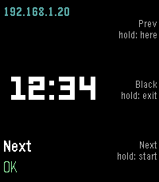
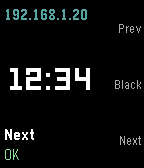
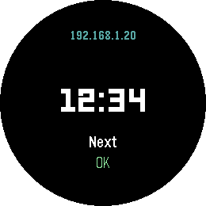

# Apuntador

Usa tu reloj Pebble como control de presentaciones para tu computadora con Linux.
*Use your Pebble watch as a presentation remote for your Linux computer.* — [English below](#english)

<p align="center">
  
  
  
</p>

## Cómo funciona

```
Reloj ──Bluetooth──▶ App Pebble del teléfono (PebbleKit JS) ──HTTP firmado──▶ servidor en tu computadora ──uinput──▶ teclas
```

- **Watchapp** en C para todos los Pebble (aplite, basalt, chalk, diorite, emery, flint y gabbro), en español e inglés según el idioma del reloj.
- **Servidor** en Python (biblioteca estándar + [python-evdev](https://python-evdev.readthedocs.io/)) que simula un teclado con `uinput`. Funciona en Wayland y en X11, sin `xdotool`.
- **Seguridad**: cada petición va firmada con HMAC-SHA256, una marca de tiempo y un valor de un solo uso. El token nunca viaja por la red y una petición capturada no se puede repetir. Además, puedes limitar el servidor a la IP de tu teléfono.

## Botones

| Botón | Pulsación corta | Pulsación larga |
|---|---|---|
| Arriba | Diapositiva anterior (←) | Desde la diapositiva actual (Mayús+F5) · OnlyOffice: primera diapositiva (Inicio) |
| Select | Pantalla negra (B) · OnlyOffice: Tab | Salir de la presentación (Esc) |
| Abajo | Diapositiva siguiente (→) | Iniciar presentación (F5) · OnlyOffice: Ctrl+F5 |
| Atrás | Salir de la app | Doble clic: cronómetro a cero |

En pantalla: la dirección conectada, un **cronómetro de la sesión** (arranca con la primera pulsación y avisa con vibraciones a los 40 y 50 minutos, configurables) y la última acción con su resultado. Al abrir la app, una vibración corta significa conectado y dos largas, sin conexión.

## Instalación

### 1. Servidor (computadora con Linux y systemd)

```sh
git clone https://github.com/Rucolastico/pebble-apuntador.git
cd pebble-apuntador/servidor
./instalar.sh
```

El instalador:
- instala `python3-evdev` (dnf, apt, pacman o zypper);
- añade una regla udev que da acceso a `/dev/uinput` al usuario con sesión activa (sin meterte en el grupo `input`);
- abre el puerto 8765 en firewalld o ufw si están activos;
- crea y arranca el servicio de usuario `apuntador.service`;
- te muestra el **token** que tienes que poner en los ajustes de la app.

### 2. App del reloj

Instálala desde la [tienda de Pebble](https://apps.repebble.com/4b99f08452124d629e2b57c7) y abre sus ajustes en la app Pebble del teléfono:

- **Token**: el que te mostró el instalador (está en `~/.config/apuntador/token`).
- **Dirección de Tailscale** (opcional): si usas [Tailscale](https://tailscale.com), la IP 100.x de tu computadora. Se prueba primero y sirve en cualquier red.
- **Direcciones locales**: la IP de tu computadora en cada red que uses, separadas por comas.
- **Programa**: PowerPoint/LibreOffice u OnlyOffice (cambia los atajos).

El teléfono prueba las direcciones en orden y usa la primera que responda.

### 3. En cada red nueva

```sh
servidor/emparejar.sh
```

Detecta la IP de tu computadora y la de tu teléfono (por `adb`, o te la pide), **limita el servidor a tu teléfono** en esa red, comprueba desde el teléfono que llega a la computadora (algunas redes de empresa aíslan a los dispositivos) y copia la IP al portapapeles para añadirla en los ajustes. `emparejar.sh --abrir` quita la lista de IPs permitidas.

## Programas

| | PowerPoint / LibreOffice Impress | OnlyOffice |
|---|---|---|
| Iniciar | F5 | Ctrl+F5 |
| Desde la actual | Mayús+F5 | — (se usa Inicio: primera diapositiva) |
| Pantalla negra | B | — (se usa Tab) |

**OnlyOffice** abre la presentación sin darle el foco del teclado: las flechas no funcionan hasta que se hace clic en ella. En **KDE Plasma** el servidor lo resuelve solo: tras iniciar, pregunta a KWin por la ventana activa y, si es OnlyOffice a pantalla completa, hace un clic en su borde y manda ← para volver a la primera diapositiva. En otros escritorios haz un clic en la presentación al empezar.

Las teclas de cada perfil se pueden cambiar en `~/.config/apuntador/teclas.json`:

```json
{"estandar": {"black": ["W"]}, "onlyoffice": {"start_here": ["LEFTCTRL", "HOME"]}}
```

(nombres de [evdev](https://github.com/torvalds/linux/blob/master/include/uapi/linux/input-event-codes.h) sin `KEY_`; la última es la tecla y las anteriores, modificadores).

## Problemas frecuentes

- **Las teclas no hacen nada**: van a la ventana que tiene el foco; haz clic en la presentación.
- **«Sin conexión»**: ejecuta `emparejar.sh` en esa red y revisa las direcciones de los ajustes. Mira el registro con `journalctl --user -u apuntador -f`.
- **401 en el registro**: token incorrecto, o la hora del teléfono y la de la computadora difieren más de 30 s.
- **403 en el registro**: la IP del teléfono no está en `~/.config/apuntador/permitidas`; vuelve a ejecutar `emparejar.sh`.

## Compilar la watchapp

Con el [SDK de Pebble](https://developer.repebble.com/sdk/) (`uv tool install pebble-tool`, `pebble sdk install latest`):

```sh
cd watchapp
pebble build
pebble install --phone IP_DEL_TELEFONO   # o --emulator emery
```

`herramientas/iconos.py` genera los iconos y `herramientas/capturas.sh`, las capturas de la tienda.

## Licencia

[MIT](LICENSE).

---

<a id="english"></a>

# Apuntador (English)

Use your Pebble watch as a presentation remote for your Linux computer. *Apuntador* is Spanish for "pointer".

## How it works

```
Watch ──Bluetooth──▶ Pebble phone app (PebbleKit JS) ──signed HTTP──▶ server on your computer ──uinput──▶ key presses
```

- **Watchapp** in C for every Pebble (aplite, basalt, chalk, diorite, emery, flint and gabbro), in English or Spanish following the watch language.
- **Server** in Python (standard library + [python-evdev](https://python-evdev.readthedocs.io/)) that emulates a keyboard through `uinput`. Works on Wayland and X11, no `xdotool` needed.
- **Security**: every request is signed with HMAC-SHA256, a timestamp and a one-time nonce. The token never travels over the network and captured requests cannot be replayed. You can also restrict the server to your phone's IP.

## Buttons

| Button | Press | Hold |
|---|---|---|
| Up | Previous slide (←) | From current slide (Shift+F5) · OnlyOffice: first slide (Home) |
| Select | Black screen (B) · OnlyOffice: Tab | Exit the slideshow (Esc) |
| Down | Next slide (→) | Start slideshow (F5) · OnlyOffice: Ctrl+F5 |
| Back | Leave the app | Double click: reset the timer |

The screen shows the connected address, a **session timer** (starts with the first press, vibrates at 40 and 50 minutes, configurable) and the last action with its result. When the app opens, one short vibration means connected, two long ones mean no connection.

## Installation

### 1. Server (Linux computer with systemd)

```sh
git clone https://github.com/Rucolastico/pebble-apuntador.git
cd pebble-apuntador/servidor
./instalar.sh
```

The installer installs `python3-evdev` (dnf, apt, pacman or zypper), adds a udev rule that grants `/dev/uinput` to the logged-in user (without joining the `input` group), opens port 8765 in firewalld or ufw when active, creates and starts the `apuntador.service` user service, and prints the **token** for the app settings.

### 2. Watch app

Install it from the [Pebble appstore](https://apps.repebble.com/4b99f08452124d629e2b57c7) and open its settings in the Pebble phone app:

- **Token**: the one printed by the installer (stored in `~/.config/apuntador/token`).
- **Tailscale address** (optional): your computer's 100.x IP if you use [Tailscale](https://tailscale.com). Tried first; works on any network.
- **Local addresses**: your computer's IP on each network you use, comma separated.
- **Program**: PowerPoint/LibreOffice or OnlyOffice (changes the shortcuts).

The phone tries the addresses in order and uses the first one that answers.

### 3. On every new network

```sh
servidor/emparejar.sh
```

It finds your computer's and your phone's IPs (through `adb`, or asks for it), **restricts the server to your phone** on that network, checks from the phone that it can reach the computer (some corporate networks isolate devices) and copies the IP to the clipboard so you can add it in the settings. `emparejar.sh --open` removes the allow list.

## Programs

| | PowerPoint / LibreOffice Impress | OnlyOffice |
|---|---|---|
| Start | F5 | Ctrl+F5 |
| From current slide | Shift+F5 | — (Home: first slide instead) |
| Black screen | B | — (Tab instead) |

**OnlyOffice** opens the slideshow without giving it keyboard focus: arrow keys do nothing until you click on it. On **KDE Plasma** the server handles this: after starting, it asks KWin for the active window and, if it is a fullscreen OnlyOffice, clicks its edge and sends ← to go back to the first slide. On other desktops, click the slideshow once when it starts.

Keys can be changed per profile in `~/.config/apuntador/teclas.json` (see the Spanish section above for the format).

## Troubleshooting

- **Keys do nothing**: they go to the focused window; click on the slideshow.
- **"No connection"**: run `emparejar.sh` on that network and check the addresses in the settings. Watch the log with `journalctl --user -u apuntador -f`.
- **401 in the log**: wrong token, or the phone and computer clocks differ by more than 30 s.
- **403 in the log**: the phone's IP is not in `~/.config/apuntador/permitidas`; run `emparejar.sh` again.

## License

[MIT](LICENSE).
